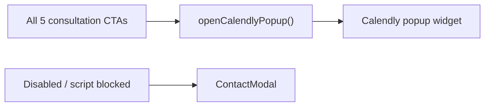
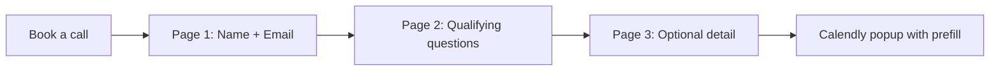

# Calendly Embed Integration Plan — Meridian CPA

**Status:** Implemented (popup v1) — pre-step form + branding QA planned (Sep 2026)  
**Date:** Sep 2026  
**Scope:** Embed-only Calendly (no Scheduling API). Admins manage event types, invitee questions, availability, and locations in Calendly. All consultation CTAs open a **Calendly popup** after optional on-site pre-step (planned §5).

**Rollout order:** Validate on **localhost** first (`.env` + restart `npm run dev`), then Vercel env vars + redeploy.

---

## 1. Context from repo inspection

| Area | Current state |
|------|----------------|
| **Framework** | **Vite 7** + **React 18** SPA (`index.html` → `src/index.tsx`) — **client-side only, no SSR** |
| **Routing** | `react-router-dom` v6 in `src/App.tsx` (`/`, `/about`, `/login`, `/dashboard/*`, `/admin/*`) |
| **Styling** | Tailwind CSS 3 + inline brand hex; design tokens: forest `#0F2A1D`, gold `#C9A84C`, cream `#F9F9F6`, body `#2C3E35` |
| **i18n** | `src/lib/translations.ts` — `en` / `zh` via `lang` prop on landing |
| **Env pattern** | `import.meta.env.VITE_*` (see `src/lib/supabase.ts`) |
| **Deploy** | Vercel (canonical URL in `index.html`) |
| **Existing booking** | `#booking` section → `PublicSessionCatalog` → Supabase workshops (`BookingSection.tsx`) |
| **Existing contact** | `ContactModal` — mailto enquiry form; opened by a **single** `openContact` handler in `Desktop.tsx` |
| **Modals** | `ContactModal`, `AdminModal` — good reference for popup accessibility |

### Product placement (recommended)

Calendly should **not replace** the Supabase workshop catalog (`#booking`). It should serve **discovery / advisory calls** (matches FAQ copy: “Book a Consultation”).

| User intent | Surface today | After Calendly |
|-------------|---------------|----------------|
| **Workshop sessions** | `#booking` → `PublicSessionCatalog` → **Supabase** | **Separate from Calendly** — see §4.7 |
| **Consultation call** | Was `ContactModal` | **Calendly popup** — all five CTAs (§4) |
| General enquiry (async) | `#contact` email / phone / WhatsApp | Unchanged — no scheduler required |

---

## 2. Recommended embed approach

### ✅ Use Calendly **popup widget only** (`widget.js` + `widget.css`)

| Option | Verdict | Reasoning |
|--------|---------|-----------|
| **Popup JS embed** | ✅ **Implemented** | All five CTAs call `Calendly.initPopupWidget`; loads `widget.js` + **`widget.css`** on first click |
| Inline `#book-a-call` section | ❌ **Removed** | Not needed — one Calendly event type, no on-page scheduler section |
| Raw iframe | ❌ | Not used |
| Calendly Scheduling API | ❌ Out of scope | Paid API |

### Popup flow — all five CTAs

- `Calendly.initPopupWidget({ url, utm })` on every consultation button click.
- `src/lib/calendly.ts` → `loadCalendlyAssets()` injects **both** stylesheet and script (required for popup to display).
- Preload happens on first CTA click; singleton promise avoids duplicate script tags.

### Script loading (CSR-safe)

1. Do **not** add Calendly to `index.html` globally.
2. Load `widget.css` + `widget.js` dynamically via `loadCalendlyAssets()` in `src/lib/calendly.ts`.
3. After changing `.env`, **restart** `npm run dev` (Vite does not hot-reload env vars).
4. If popup fails, `ContactModal` opens as fallback; check browser console for `[Calendly]` messages in dev.

---

## 3. Branding alignment

### 3.1 Can the widget match our green theme?

**Yes — partially.** Meridian forest green (`#0F2A1D`) is already passed via embed params in `src/lib/calendly.ts`:

| Param | Meridian value | What it affects |
|-------|----------------|-----------------|
| `primary_color` | `0F2A1D` | Selected date, time-slot buttons, primary actions |
| `text_color` | `2C3E35` | Body text inside widget |
| `background_color` | `F9F9F6` | Widget background (cream) |

Set in `.env` as `VITE_BRAND_PRIMARY` / `VITE_BRAND_BG` (or `VITE_CALENDLY_*_COLOR` overrides).

**If the widget still looks default Calendly blue:**

1. **Restart dev server** after `.env` changes — Vite bakes env at startup.
2. **Hard-refresh** the browser (Ctrl+Shift+R) — old popup script may be cached.
3. **Verify params on URL** — open DevTools → Network → filter `calendly.com` → confirm booking URL includes `primary_color=0F2A1D`.
4. **Calendly account branding** — Calendly → **Account** → **Branding**: set logo + brand color to `#0F2A1D` so standalone and embed views align.
5. **Paid vs free** — some account-level styles may differ; embed params still apply to buttons/accents on most plans.

**Also set in Calendly admin (recommended — doubles up with embed):**

- Branding → logo (Meridian mark)
- Brand color → `#0F2A1D`
- Button/text colors aligned with site

### 3.2 Limitations (document for stakeholders)

- **No custom CSS** inside the Calendly iframe — only URL params + Calendly account branding.
- Font will be Calendly’s, not the site serif/sans pairing.
- “Powered by Calendly” may still appear.
- **Our pre-step modal** (planned §5) can be fully on-brand (forest green, cream, gold rule) — only the Calendly step is Calendly-controlled.

### 3.3 Pre-step modal branding (planned)

When we add the multi-page form before Calendly opens, style it like `ContactModal` / site modals:

- Background `#F9F9F6`, headings `#0F2A1D`, accent `#C9A84C`
- Primary button forest green; secondary ghost
- This gives users a **fully branded** first impression before the Calendly iframe

---

## 3 (legacy). Embed params reference

Append to event URL via `buildStyledEventUrl()` in `src/lib/calendly.ts`:

| Param | Meridian value | Notes |
|-------|----------------|-------|
| `hide_gdpr_banner` | `0` (default) | Only set `1` with legal approval |
| `hide_landing_page_details` | `1` | Less Calendly marketing chrome |

Example:

```text
https://calendly.com/your-org/discovery-call?primary_color=0F2A1D&text_color=2C3E35&background_color=F9F9F6
```

---

## 4. CTA wiring — “Contact us” & “Book Now” → Calendly

**Product decision (locked):** All **five** consultation CTAs open the **Calendly popup**. No `#book-a-call` inline section. `ContactModal` is fallback only.

### 4.2 CTA labels & behavior (locked — Sep 2026)

All consultation CTAs use **“Book a call”** (EN) / **“預約通話”** (buttons) or **“預約諮詢”** (header nav) and open the **Calendly popup**.

| # | Location | Label (EN) | Action | `utm_content` |
|---|----------|------------|--------|---------------|
| 1 | Hero | Book a call | Calendly popup | `hero-book-now` |
| 2 | Header nav | Book a call | Calendly popup | `header-contact` |
| 3 | Services section | Book a call | Calendly popup | `services-cta` |
| 4 | Booking advisory banner | Book a call | Calendly popup | `booking-banner` |
| 5 | Get in touch section | Book a call | Calendly popup | `contact-section` |

**Async contact (no modal):** `#contact` section provides **WhatsApp**, **mailto email**, and **phone**. `ContactModal` (enquiry form) is **fallback only** when Calendly fails.

Shared copy key: `translations.cta.bookACall` — used by hero, services, contact, and booking banner buttons.



### 4.3 Handler architecture (`Desktop.tsx`)

```tsx
const { openCalendlyPopup } = useCalendlyBooking({ onFallback: openContactFallback });

<HeroSection onBookNowClick={() => openCalendlyPopup("hero-book-now")} />
<TopNavigationSection onContactClick={() => openCalendlyPopup("header-contact")} />
// ... services, booking banner, contact section — same pattern
```

### 4.7 “Book a Session” vs Calendly (important)

These are **two different systems**:

| Section | What it is | Data source |
|---------|------------|-------------|
| **Book a Session** (`#booking`) | Workshop / info session catalog | **Supabase** `sessions` table |
| **Consultation CTAs** | Discovery call scheduling | **Calendly** popup |

**“Failed to load sessions”** comes from `PublicSessionCatalog` → `fetchPublicSessions()` (Supabase), **not** Calendly. Common causes:

1. **Missing env on deploy** — `VITE_SUPABASE_URL` / `VITE_SUPABASE_ANON_KEY` not set in Vercel Preview
2. **`app_settings` migration** not applied on remote Supabase
3. **Dev server not restarted** after `.env` changes
4. Previously: logged-in user booking fetch failed and masked session load (fixed — errors decoupled)

Calendly popup failing silently used to open `ContactModal` (mailto form) — check dev console for `[Calendly] Popup failed`.

### 4.4 `ContactModal` fate

**Demote to fallback** when `VITE_CALENDLY_ENABLED=false`, script timeout, or adblock. Remove from happy path when Calendly is on. `#contact` email/WhatsApp remain for async enquiries.

### 4.5 Copy & labels (locked)

| Element | EN | ZH | Notes |
|---------|-----|-----|-------|
| Header nav CTA | Book a call | 預約諮詢 | `nav.bookACall` |
| All other Calendly buttons | Book a call | 預約通話 | `cta.bookACall` |
| Get in touch — async | WhatsApp / email / phone | Same | No enquiry modal on happy path |
| Enquiry modal | Send an enquiry | 發送查詢 | Fallback only |

FAQ and booking banner copy updated to reference “Book a call” and direct async enquiries to `#contact`.

### 4.6 Localhost setup (do this before Vercel)

1. Add to `.env` (project root):
   ```env
   VITE_CALENDLY_URL=https://calendly.com/your-org/your-event
   VITE_BRAND_PRIMARY=0F2A1D
   VITE_BRAND_BG=F9F9F6
   ```
2. **Stop and restart** `npm run dev`.
3. Click **Book a call** (hero, header, or contact section) — Calendly modal should appear.
4. If mailto `ContactModal` opens instead → check console for `[Calendly]` errors (missing env, adblock, or script blocked).

**Do not** remove `#booking` or Supabase workshop flows.

---

## 5. Pre-step questionnaire & prefill (planned v2)

### 5.1 Goal

Before opening the Calendly popup, show a **multi-page Meridian-branded modal** that collects name, email, and up to **5 qualifying questions**, then passes answers into Calendly via **`prefill`** so the invitee does not re-type everything.



### 5.2 Recommended questions (CPA firm — max 5 before widget)

Ask only what helps triage the call. Suggested set:

| # | Question | Type | Required | Why |
|---|----------|------|----------|-----|
| 1 | **Full name** | Text | Yes | Personalise call + Calendly `prefill.name` |
| 2 | **Work email** | Email | Yes | Confirmation + Calendly `prefill.email` |
| 3 | **Company / entity name** | Text | Yes | Core context for CPA intake |
| 4 | **What do you need help with?** | Single select | Yes | Routes conversation: Audit & compliance / Profits tax / Bookkeeping & cloud / Company secretarial / General advisory |
| 5 | **Brief context** (optional) | Textarea | No | Year-end date, urgency, or scope — “Tell us briefly what you’d like to discuss” |

**Page layout (recommended):**

| Page | Fields | Primary button |
|------|--------|----------------|
| **1 of 3** | Name, email | Continue |
| **2 of 3** | Company, service line (Q4) | Continue |
| **3 of 3** | Brief context (Q5) | **Continue to schedule** → opens Calendly |

Keep it to **3 short pages** — not 5 separate pages for 5 questions (reduces drop-off).

### 5.3 Mapping into Calendly (embed prefill)

Calendly `initPopupWidget` supports:

```ts
prefill: {
  name: string;
  email: string;
  customAnswers: {
    a1: string; // must match 1st custom invitee question in Calendly admin
    a2: string; // 2nd question, etc.
  };
}
```

**Critical:** `a1`, `a2`, … map to **Invitee questions on the event type in order** — not by label. When implementing:

1. In Calendly → Event type → **Invitee questions**, create questions in the **same order** as the pre-step form (company, service line, brief context).
2. Use Calendly’s test booking to confirm `a1`/`a2`/`a3` mapping.
3. Pass name/email from page 1 — Calendly may skip re-asking if already prefilled.

**Logged-in users (optional enhancement):** If `useAuth` has profile email/name, pre-populate page 1 fields.

### 5.4 What stays in Calendly vs on-site

| Data | Collect where | Reason |
|------|---------------|--------|
| Name, email, intake questions | **On-site pre-step** (planned) | Branded UX; prefill into Calendly |
| Date & time | **Calendly only** | Availability engine lives in Calendly |
| Phone, location preference | **Calendly invitee questions** (optional) | Or add as Q6+ on-site if needed |
| GDPR / scheduling confirmations | **Calendly** | Required by scheduler |

**Do not duplicate** the same questions on-site and in Calendly unless prefill is wired — users hate typing twice.

### 5.5 Implementation outline (when coding)

| File | Purpose |
|------|---------|
| `src/components/BookCallPreflightModal.tsx` | Multi-page form; Meridian styling |
| `src/hooks/useCalendlyBooking.ts` | Open preflight first → on complete call `openCalendlyPopupWidget({ prefill })` |
| `src/lib/calendly.ts` | Extend `CalendlyPopupOptions.prefill.customAnswers` |
| `src/lib/translations.ts` | `bookCallPreflight.*` EN/ZH |

Reuse patterns from `ContactModal` (focus trap, Escape, body scroll lock).

### 5.6 Invitee questions (Calendly-side — today)

Today, questions are configured only in **Calendly dashboard** and appear inside the widget after date/time selection. v2 pre-step reduces duplicate entry for name/email/intake fields configured as custom questions.

---

## 17. Availability & timezone (why midnight slots?)

### 17.1 Does the website sync hours with Calendly?

**No.** With embed-only integration, **all availability is managed in Calendly** — not in Supabase, not in `.env`, not in our code. The website only opens the scheduler; it cannot push 9am–5pm rules to Calendly.

### 17.2 Why you might see midnight / early-morning slots (e.g. 00:00, 00:30)

Your screenshot shows **“Hong Kong Time”** with slots starting at **00:00**. That usually means the **host’s Calendly timezone ≠ Hong Kong**, even though the invitee view is in HK.

**Common cause:** Host account timezone is **US Pacific** (or similar) with availability **9:00 AM – 5:00 PM** in *that* timezone. Converted to Hong Kong:

| Host local (example) | Shows in HK as |
|----------------------|----------------|
| 9:00 AM Pacific | **12:00 AM (midnight)** HK same calendar date |
| 5:00 PM Pacific | **8:00 AM** HK next calendar date |

So “9–5” in Calendly is **9–5 in the host timezone**, not automatically 9–5 HK.

### 17.3 Fix checklist (Calendly admin — no code)

1. **Profile timezone** — Calendly → **Account settings** → **Timezone** → set **`Asia/Hong_Kong`** for HK-based firm.
2. **Event type** — Confirm `VITE_CALENDLY_URL` points to the same event you edited (e.g. `new-meeting` vs “Discovery Call” — different URLs = different availability).
3. **Availability** — Event type → **Availability** → weekly hours **Mon–Fri 9:00–17:00** (verify **after** timezone is HK).
4. **Date overrides** — Check for holidays / custom hours adding odd slots.
5. **Buffers & minimum notice** — Won’t cause midnight slots but affects what appears.
6. **Re-test** — Open embed in incognito; pick a weekday; expect **09:00–17:00 HK** slots.

### 17.4 Invitee timezone display

Calendly shows times in the **invitee’s local timezone** (browser), with a selector (your screenshot: “Hong Kong Time”). That part works correctly — the issue is almost always **host-side availability timezone**, not the embed.

### 17.5 What we cannot fix in code (embed-only)

- Force 9–5 HK from the website
- Hide “wrong” slots via CSS
- Sync Supabase workshop hours with Calendly

**Scheduling API** (paid, out of scope) would be required to build custom slot UI on-site.

---

## 6. Reliability & performance

| Concern | Mitigation |
|---------|------------|
| **CLS** | Reserve `min-h-[700px]` (desktop) / `min-h-[620px]` (mobile); skeleton until iframe loads |
| **Lighthouse** | Lazy-load script when `#book-a-call` is near viewport (`IntersectionObserver` with `rootMargin: 200px`) **or** on first CTA click for popup-only pages |
| **Duplicate script** | Singleton promise in `loadCalendlyScript()` — resolve once `window.Calendly` exists |
| **Route changes** | On unmount: clear inline parent `innerHTML`; avoid double `initInlineWidget` |
| **SPA navigation** | If using `/book-a-call` route, mount embed in `useEffect` keyed on `location.pathname` |
| **Failed load** | Show fallback UI: “Scheduler unavailable” + mailto / WhatsApp / `ContactModal` button |
| **Adblockers** | Some block `calendly.com`; detect script `onerror` / timeout → fallback |

**No SSR implications** — Vite SPA only renders embed after hydration.

---

## 7. Security & privacy

| Topic | Notes |
|-------|-------|
| **Data passed from our site** | v1: only public event URL + color params. v2 prefill: name/email from profile or form (user-consented). |
| **Data stored** | Booking data lives in **Calendly** (and invitee’s calendar). Not in Supabase unless you add webhooks later. |
| **Third-party iframe** | Content served from `calendly.com`; subject to Calendly privacy policy. |
| **Cookies** | Calendly may set analytics/session cookies inside iframe; may interact with site cookie banners. Document in privacy policy. |
| **GDPR banner** | Calendly shows its own GDPR notice unless `hide_gdpr_banner=1` — **get legal sign-off** before hiding. |
| **CSP** (if added later) | Allow `frame-src https://calendly.com`; `script-src https://assets.calendly.com` |
| **Secrets** | Event URL is **not secret** (public scheduling link). No API keys for embed-only. |

---

## 8. Environment & configuration

### Vercel env vars (`VITE_*` — exposed to client, expected for embed URL)

| Variable | Required | Example | Purpose |
|----------|----------|---------|---------|
| `VITE_CALENDLY_EVENT_URL` | Yes | `https://calendly.com/your-org/discovery-call` | Base event link (no query string required if using init styles) |
| `VITE_CALENDLY_PRIMARY_COLOR` | No | `0F2A1D` | Default forest green |
| `VITE_CALENDLY_TEXT_COLOR` | No | `2C3E35` | Body text |
| `VITE_CALENDLY_BACKGROUND_COLOR` | No | `F9F9F6` | Cream |
| `VITE_CALENDLY_HIDE_GDPR_BANNER` | No | `false` | String boolean — default show banner |
| `VITE_CALENDLY_ENABLED` | No | `true` | Feature flag — `false` hides section + shows fallback |

### Central config module

**Add:** `src/lib/calendly.ts`

- `getCalendlyConfig()` — reads env, builds URL with query params
- `loadCalendlyScript(): Promise<void>`
- `initCalendlyInline(parent: HTMLElement, options?)`
- `openCalendlyPopup(utmContent?: string)` — per-CTA UTM tagging
- Type augmentation for `window.Calendly` (minimal)

### Local dev

- Single **`.env`** at project root (gitignored) — restart `npm run dev` after edits
- Document vars in this plan; no separate `.env.example` required for solo dev

---

## 9. Files to add or modify

### New files

| Path | Purpose |
|------|---------|
| `src/lib/calendly.ts` | Config, script loader, init helpers, feature flag |
| `src/components/CalendlyInlineEmbed.tsx` | Inline widget + skeleton + error fallback |
| `src/hooks/useCalendlyBooking.ts` | `scrollToBookACall`, `openCalendlyPopup(utmContent)`, fallback detection |
| `src/screens/Desktop/sections/BookACallSection/BookACallSection.tsx` | Section wrapper (title, cream bg, embed) |
| `src/screens/BookACall/BookACallPage.tsx` | *(Optional)* standalone `/book-a-call` page |
| `.env.example` | Document `VITE_CALENDLY_*` vars |
| `Implementation/CALENDLY_INTEGRATION_PLAN.md` | This document |

### Modify

| Path | Change |
|------|--------|
| `src/screens/Desktop/Desktop.tsx` | Replace `openContact` with Calendly handlers; `ContactModal` only as fallback |
| `src/screens/Desktop/sections/HeroSection/HeroSection.tsx` | `onBookNowClick` → scroll to `#book-a-call` (no prop rename needed) |
| `src/screens/Desktop/sections/TopNavigationSection/TopNavigationSection.tsx` | `onContactClick` → Calendly popup; optional nav link `#book-a-call` |
| `src/screens/Desktop/sections/MainContentSection/MainContentSection.tsx` | Insert `<BookACallSection />` after services; pass popup handler with `utm_content` |
| `src/screens/Desktop/sections/ContactSection/ContactSection.tsx` | `onBookClick` → Calendly popup (via parent) |
| `src/screens/Desktop/sections/BookingSection/BookingSection.tsx` | Pass through popup handler to `PublicSessionCatalog` |
| `src/lib/translations.ts` | `bookACall.*`, nav label, FAQ copy tweak |
| `src/App.tsx` | *(Optional)* route `/book-a-call` → `BookACallPage` |
| `Implementation/IMPLEMENTATION_LANDING_PAGE_BOOK.md` | CTA table: hero scroll vs header popup vs workshops |
| `Implementation/IMPLEMENTATION_ROADMAP.md` | Calendly as post-prototype enhancement *(optional)* |

### Do **not** modify

- Admin screens (`/admin/*`) — no on-site Calendly admin
- Supabase booking libs — workshop flow stays separate
- `ContactModal.tsx` — keep file; remove from default path only

---

## 10. Step-by-step task list

### Phase A — Calendly account setup (non-code)

- [ ] A1. Create / confirm Calendly org account
- [ ] A2. Create **one** event type (e.g. “Discovery call — 30 min”)
- [ ] A3. Set location (Zoom / Google Meet / phone / in-person)
- [ ] A4. Configure **invitee questions** (company, service line, notes)
- [ ] A5. Set availability, timezone (**Asia/Hong_Kong**), buffers
- [ ] A6. Calendly branding: upload logo, align colors with `#0F2A1D` / `#C9A84C`
- [ ] A7. Copy **event scheduling URL** for env var
- [ ] A8. Send test invite to team inbox; verify questions + location in email

### Phase B — Config & loader

- [ ] B1. Add `.env.example` with `VITE_CALENDLY_*`
- [ ] B2. Set vars in Vercel Preview + Production
- [ ] B3. Implement `src/lib/calendly.ts` (config + script singleton + types)
- [ ] B4. Unit-test config builder (URL params, disabled flag) if test harness exists; else manual

### Phase C — Inline embed (primary)

- [ ] C1. Build `CalendlyInlineEmbed.tsx` (skeleton, min-height, error state)
- [ ] C2. Lazy-load script (viewport or mount — pick one, document choice)
- [ ] C3. Build `BookACallSection.tsx` (header + embed, `id="book-a-call"`)
- [ ] C4. Insert section in `MainContentSection.tsx`
- [ ] C5. Add translations EN/ZH
- [ ] C6. Add nav anchor in `TopNavigationSection.tsx`

### Phase D — CTA wiring (all five — required)

- [ ] D1. Implement `useCalendlyBooking` hook (`scrollToBookACall`, `openCalendlyPopup`)
- [ ] D2. Wire CTA #1: `HeroSection` → scroll to `#book-a-call`
- [ ] D3. Wire CTA #2: `TopNavigationSection` “Contact us” (desktop + mobile) → popup (`header-contact`)
- [ ] D4. Wire CTA #3: services button in `MainContentSection` → popup (`services-cta`)
- [ ] D5. Wire CTA #4: advisory banner in `PublicSessionCatalog` → popup (`booking-banner`)
- [ ] D6. Wire CTA #5: `ContactSection` `onBookClick` → popup (`contact-section`)
- [ ] D7. Fallback: when Calendly disabled/fails, restore `ContactModal` or mailto/WhatsApp
- [ ] D8. QA all five entry points + popup on mobile Safari (scroll lock, address bar)

### Phase D2 — Standalone route (optional)

- [ ] D2.1. Add `/book-a-call` route + minimal layout (header/footer or embed-only)
- [ ] D2.2. Link from FAQ answer / footer

### Phase E — Polish & docs

- [ ] E1. Fallback when `VITE_CALENDLY_ENABLED=false` or script fails
- [ ] E2. Update `IMPLEMENTATION_LANDING_PAGE_BOOK.md` CTA table
- [ ] E3. Privacy policy note (third-party scheduler, Calendly link)

### Phase G — Pre-step questionnaire (planned v2)

- [ ] G1. Product sign-off on 5 questions (§5.2)
- [ ] G2. Align Calendly invitee question order with `customAnswers` a1/a2/a3
- [ ] G3. Build `BookCallPreflightModal.tsx` (3 pages, Meridian styling)
- [ ] G4. Wire `useCalendlyBooking` → preflight → `openCalendlyPopupWidget({ prefill })`
- [ ] G5. Prefill logged-in profile when available
- [ ] G6. QA: no duplicate prompts in Calendly; booking completes with prefilled data in Calendly admin

### Phase H — Branding & availability QA (Calendly admin + env)

- [ ] H1. Set Calendly account timezone to **Asia/Hong_Kong**
- [ ] H2. Set event availability Mon–Fri 9:00–17:00 HK; verify slots in embed
- [ ] H3. Set Calendly account branding color `#0F2A1D`; confirm embed params in Network tab
- [ ] H4. Confirm `VITE_CALENDLY_URL` matches the event type you configured

### Phase F — QA & rollout (see §11–12)

---

## 11. QA checklist

### Functional

- [ ] Calendly popup opens from all five “Book a call” CTAs
- [ ] Complete booking end-to-end → appears in Calendly admin + calendar email
- [ ] **Availability:** weekday slots show **9:00–17:00 Hong Kong Time** (after Calendly admin fix §17)
- [ ] **Branding:** time-slot buttons use forest green `#0F2A1D`, not default blue (§3.1)
- [ ] Invitee questions appear in embed (or prefill skips duplicates in v2)
- [ ] Each CTA passes correct `utm_content`
- [ ] `VITE_CALENDLY_ENABLED=false` → fallback modal
- [ ] Broken URL → fallback, not infinite spinner
- [ ] *(v2)* Pre-step modal prefills name/email into Calendly

### Cross-browser / device

- [ ] Chrome desktop
- [ ] Safari desktop (macOS)
- [ ] Safari iOS (iPhone)
- [ ] Chrome Android
- [ ] Narrow viewport 320px width

### Performance

- [ ] No Calendly script on `/login`, `/admin/*` (if lazy-scoped correctly)
- [ ] Lighthouse on `/` — note TBT impact; script should not block first paint of hero
- [ ] No large layout shift when embed appears (CLS < 0.1 on section)

### Privacy / compliance

- [ ] GDPR banner visible by default (unless legal approved `hide_gdpr_banner`)
- [ ] Site cookie banner (if any) documented alongside Calendly cookies
- [ ] Privacy policy mentions Calendly as processor

### Adblock / network

- [ ] uBlock / Brave shields — fallback message appears
- [ ] Slow 3G throttle — skeleton shows, then embed or timeout fallback

### Regression

- [ ] `#booking` workshop catalog still works
- [ ] `ContactModal` fallback works when `VITE_CALENDLY_ENABLED=false`
- [ ] `#contact` email / phone / WhatsApp unchanged
- [ ] EN/ZH language toggle doesn’t break CTAs (Calendly widget may stay EN)

---

## 12. Rollout plan

| Stage | Action |
|-------|--------|
| **1. Feature flag off** | Merge code with `VITE_CALENDLY_ENABLED=false` in production |
| **2. Preview deploy** | Vercel preview URL + real Calendly event (test mode or hidden event) |
| **3. Internal QA** | Team books test slots; verify emails + questions |
| **4. Enable prod** | `VITE_CALENDLY_ENABLED=true` on production |
| **5. Soft launch** | Nav link live; monitor Calendly dashboard for real bookings |
| **6. Fallback** | If Calendly outage: set flag false or swap CTA to `ContactModal` / WhatsApp |

**Rollback:** Toggle env flag — no DB migration, no Supabase coupling.

---

## 13. Future upgrades (post-embed)

| Upgrade | Requires | Notes |
|---------|----------|-------|
| **Pre-step modal + prefill** | Embed only | §5 — planned v2 |
| **Logged-in prefill** | Embed + `useAuth` | Auto-fill page 1 from profile |
| **UTM tracking** | Embed `utm` params | Already wired per CTA |
| **Multiple event types** | Multiple URLs or routing forms | Audit vs tax discovery |
| **Calendly webhooks** | Paid plan + Edge Function | Sync to Supabase / CRM |
| **Scheduling API** | Paid Calendly | Custom slot UI — out of scope |
| **ZH event type** | Second Calendly event | Switch URL when `lang === 'zh'` |
| **GA conversion events** | Calendly JS event callbacks | Track `event_scheduled` |

---

## 14. Open product decisions (remaining)

| # | Decision | Status |
|---|----------|--------|
| 1 | All five CTAs → Calendly popup | ✅ **Locked** |
| 2 | CTA label “Book a call” | ✅ **Locked** |
| 3 | Enquiry modal | ✅ **Fallback only** |
| 4 | Pre-step 5 questions before widget | **Recommend §5.2** — confirm with product |
| 5 | Pre-step page count (3 pages vs 5) | **Recommend 3 pages** — pending sign-off |
| 6 | Calendly account timezone HK + 9–5 | **Action in Calendly admin** — §17 |
| 7 | GDPR banner | Show (recommended) or hide with legal approval |
| 8 | Single vs dual Calendly events | One URL vs separate audit/tax types |

---

## 15. Effort estimate

| Phase | Estimate |
|-------|----------|
| Calendly admin (timezone, branding, questions) | 1–2 hours |
| Popup v1 (done) | — |
| Pre-step modal + prefill (v2) | 1–2 days |
| Branding QA (green theme verification) | 1–2 hours |
| QA + Vercel env | 2–3 hours |

---

## 16. References

- [Calendly embed overview](https://help.calendly.com/hc/en-us/articles/223147027-Embed-options-overview)
- [Inline embed](https://help.calendly.com/hc/en-us/articles/223147027-Embed-options-overview#inline-embed)
- [Popup widget](https://help.calendly.com/hc/en-us/articles/223147027-Embed-options-overview#popup-embed)
- [Advanced embed parameters](https://help.calendly.com/hc/en-us/articles/223147027-Embed-options-overview) (colors, hide_gdpr_banner)
- [Calendly prefill](https://help.calendly.com/hc/en-us/articles/223147767-How-to-pre-fill-invitee-information-in-your-embed)
- [Calendly timezone & availability](https://help.calendly.com/hc/en-us/articles/223147067-Event-type-availability)
- Internal: `Implementation/IMPLEMENTATION_ROADMAP.md` (prototype complete; Calendly is additive)
